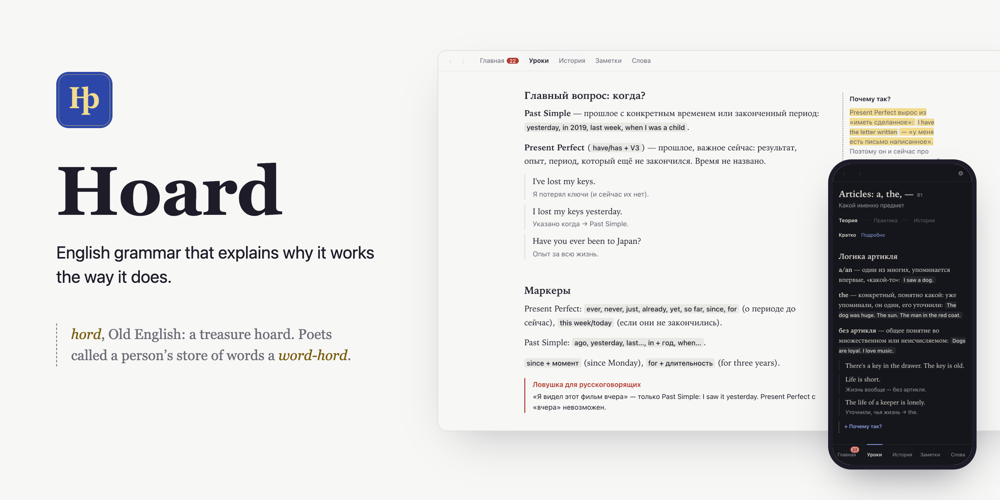

<picture>
  <source media="(prefers-color-scheme: dark)" srcset="docs/hero-en-dark.png">
  
</picture>

**English** · [Русский](README.ru.md)

# Hoard

Hoard teaches English grammar from A1 to C1 and explains why each rule works the way it does. Every rule comes with a short story from the history of the language. Hoard runs on your computer and your phone, works offline, needs no account and uses no AI.

**[Open in the browser](https://shevlukvasiliy.github.io/Hoard-English/)** · **[Download for Mac, Windows or Linux](https://github.com/ShevlukVasiliy/Hoard-English/releases/latest)**

## Why "Hoard"

In Old English *hord* meant a treasure hoard, and poets called a person's store of words their *word-hord*. That is the idea behind the app. Grammar is easier to remember when you know where it came from: *have* in "I have done" once meant "to own", *the* grew out of "that", and *a* grew out of "one". Everything you save in Hoard is marked in gold, so over time you build your own hoard.

## What's inside

- **36 lessons in 15 blocks**, from *to be* to inversion and cleft sentences. Each lesson has theory, then practice, then a story about the language.
- **"Why is it so?" notes in the margins.** There are 41 of them, each explaining a rule through its history.
- **History of English.** 36 stories arranged by era, from Old English to today, each in a short and a full version.
- **Traps for your native language.** There are 120 of them, covering the mistakes speakers of your language really make: *"I saw this film yesterday" never takes Present Perfect*, *advice is uncountable*.
- **Practice that changes every time.** Each lesson pulls 10 random tasks from a bank of 15–20: choose, fill the gap, put words in order, fix the mistake, rewrite the sentence.
- **Block finals.** Each block ends with a test, a round of traps and a blitz of 15 questions in 60 seconds. Nothing is locked; you go at your own pace.
- **Mistakes come back.** Every wrong answer returns after 1, 3, 7 and 21 days, until you get it right.
- **A placement test** finds your level in about 20–25 questions and suggests where to start.
- **Notes.** Highlight any sentence in a lesson or story and it is saved in gold. You can send notes and stories to Anki as cards.
- **Anki integration (desktop).** Hoard reads your Anki deck, finds the grammar from its lessons in your own phrases, builds exercises from them, and suggests new words at your level.
- **Daily reminders (desktop)** on the days and at the time you choose.

## Screenshots

<table>
  <tr>
    <td width="50%">
      <picture><source media="(prefers-color-scheme: dark)" srcset="docs/screenshots/home-dark.png"></picture>
      <p align="center">Home: what to do next</p>
    </td>
    <td width="50%">
      <picture><source media="(prefers-color-scheme: dark)" srcset="docs/screenshots/gloss-dark.png"></picture>
      <p align="center">A lesson with a margin note and a trap</p>
    </td>
  </tr>
  <tr>
    <td width="50%">
      <picture><source media="(prefers-color-scheme: dark)" srcset="docs/screenshots/stories-dark.png"></picture>
      <p align="center">History of English, era by era</p>
    </td>
    <td width="50%">
      <picture><source media="(prefers-color-scheme: dark)" srcset="docs/screenshots/map-dark.png"></picture>
      <p align="center">Lessons and progress by topic</p>
    </td>
  </tr>
  <tr>
    <td width="50%">
      <picture><source media="(prefers-color-scheme: dark)" srcset="docs/screenshots/notes-dark.png"></picture>
      <p align="center">Your notes, ready for Anki</p>
    </td>
    <td width="50%">
      <picture><source media="(prefers-color-scheme: dark)" srcset="docs/screenshots/blitz-dark.png"></picture>
      <p align="center">Blitz: 15 questions in a minute</p>
    </td>
  </tr>
</table>

<p align="center">
  <picture><source media="(prefers-color-scheme: dark)" srcset="docs/screenshots/phone-home-dark.png"></picture>
  &nbsp;&nbsp;
  <picture><source media="(prefers-color-scheme: dark)" srcset="docs/screenshots/phone-lesson-dark.png"></picture>
</p>

## Languages

Theory for A1–B1 is written in your native language, and from B2 on it is in English. Traps are always in your native language and written for it, not translated, because every language trips over different things.

| Native language | Status |
|---|---|
| Russian | Ready |
| Ukrainian | Planned |
| Spanish | Planned |
| German | Planned |
| Polish | Planned |

The app interface is in Russian for now. An English interface is coming with the other languages.

## Install

**Mac, Windows, Linux.** Download the installer from [Releases](https://github.com/ShevlukVasiliy/Hoard-English/releases/latest). The builds are not signed yet, so the first launch needs one extra step:
- macOS: open Hoard once and close the warning. Then go to **System Settings → Privacy & Security**, scroll down and click **Open Anyway** next to Hoard.
- Windows: in the SmartScreen window, click **More info**, then **Run anyway**.

**iPhone and Android.** Open the [web version](https://shevlukvasiliy.github.io/Hoard-English/) and add it to your home screen. On iPhone, use Safari: tap **Share**, then **Add to Home Screen**. After that it works offline like an app. Anki and reminders are only available on the desktop.

## Sync between devices

Hoard has no server. To use it on your computer and your phone, connect your GitHub account in Settings. Hoard keeps your progress in a private (secret) gist that only you can see, and you can encrypt it with a password. Each device writes its own log of what you did, so nothing is overwritten. Your laptop and phone end up with the same progress, even if you studied on both offline.

## Privacy

Your progress, notes and settings stay on your device. Hoard sends nothing anywhere, except to your own gist if you turn on sync and to Anki on your computer if you use it. There is no analytics, tracking or AI.

## Sources

- **Grammar and vocabulary levels**: CEFR-J Grammar Profile (ver. 20180315) and CEFR-J Wordlist (ver. 1.5), Yukio Tono, Tokyo University of Foreign Studies, [cefr-j.org](http://www.cefr-j.org/download.html), via [Open Language Profiles](https://github.com/openlanguageprofiles/olp-en-cefrj). They are free for research and commercial use with attribution. The original wordlist is in `shared/data/` and is not covered by this project's license.
- **Lessons, exercises, the placement test bank, traps and stories** are original texts written for Hoard. They do not copy textbooks.
- **Era epigraphs** in "History of English" come from public-domain texts: the Old English Lord's Prayer, Chaucer, Shakespeare and Samuel Johnson.
- **Further reading** on the history of English, if the stories get you curious: David Crystal, *The Stories of English*; Albert C. Baugh and Thomas Cable, *A History of the English Language*; the [Online Etymology Dictionary](https://www.etymonline.com/).
- **[Anki](https://apps.ankiweb.net/)** and **[AnkiConnect](https://ankiweb.net/shared/info/2055492159)**: Hoard only reads your collection, and adds cards through AnkiConnect.

## For developers

Hoard is built with Tauri 2 (desktop) and React with Vite. The phone version is the same build served as a PWA on GitHub Pages. You'll need [Bun](https://bun.sh) and, for the desktop app, Rust.

```bash
bun install
bun run app:dev    # desktop app
bun run dev        # web version at localhost:1420, data in localStorage
```

Checks before a commit:

```bash
bun run typecheck
bun test
cd src-tauri && cargo check
```

In the web version you can open any screen by putting its route in the address, for example `http://localhost:1420/#{"name":"lesson","id":"past-perfect"}`. On the desktop, data lives in `~/.eng-teacher/`. The Anki collection is opened read-only; new cards go through AnkiConnect and wait in a queue while Anki is closed.

Desktop installers are built by GitHub Actions when a `v*` tag is pushed. Screenshots are regenerated with `bun scripts/screenshots.ts` while `bun run dev` is running. The product idea is described in [CONCEPT.md](CONCEPT.md), the visual language in [UX.md](UX.md), and the plan in [STAGE_PLAN.md](STAGE_PLAN.md). All three are in Russian.

## License

[MIT](LICENSE)
