<picture>
  <source media="(prefers-color-scheme: dark)" srcset="docs/hero-ru-dark.png">
  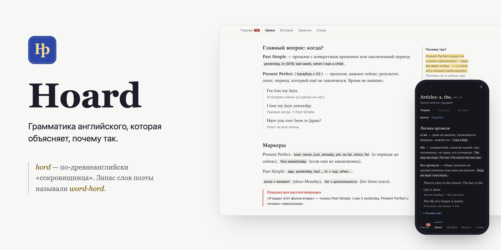
</picture>

[English](README.md) · **Русский**

# Hoard

Hoard — грамматика английского от A1 до C1, которая объясняет, почему правило устроено именно так. К каждому правилу есть короткая история из прошлого языка. Работает на компьютере и телефоне, без интернета, без регистрации и без ИИ.

**[Открыть в браузере](https://shevlukvasiliy.github.io/Hoard-English/)** · **[Скачать для Mac, Windows и Linux](https://github.com/ShevlukVasiliy/Hoard-English/releases/latest)**

## Почему Hoard

Древнеанглийское *hord* — «сокровищница». Запас слов поэты называли *word-hord*. На этой идее построено приложение: грамматику легче запомнить, когда знаешь, откуда она взялась. *have* в «I have done» когда-то значило «владеть», *the* выросло из «that», *a* — из «one». Всё, что ты сохраняешь, Hoard отмечает золотом, и со временем у тебя собирается своя сокровищница.

## Что внутри

- **36 уроков в 15 блоках**: от *to be* до инверсии и cleft sentences. Урок идёт так: теория, практика, история про язык.
- **Глоссы «Почему так?» на полях.** Их 41, каждая объясняет правило через историю.
- **История языка**: 36 историй по эпохам, от древнеанглийского до наших дней, в короткой и полной версии.
- **Ловушки под твой родной язык.** Их 120, это ошибки, которые на самом деле делают носители твоего языка: *«Я видел этот фильм вчера» — только Past Simple*, *advice неисчисляемое*.
- **Практика каждый раз новая.** В урок попадают 10 случайных заданий из банка в 15–20: выбрать ответ, вставить слово, собрать фразу, исправить ошибку, перестроить предложение.
- **Финал блока**: контрольная, ловушки и блиц — 15 вопросов за 60 секунд. Ничего не блокируется, темп выбираешь сам.
- **Ошибки возвращаются** через 1, 3, 7 и 21 день, пока не закрепятся.
- **Входной тест** за 20–25 вопросов определяет уровень и предлагает, с чего начать.
- **Заметки.** Выдели любую фразу в уроке или истории, и она сохранится золотом. Заметки и истории можно отправить в Anki карточками.
- **Anki (на компьютере).** Hoard читает твою колоду, находит в твоих фразах грамматику из уроков, делает из них задания и предлагает новые слова твоего уровня.
- **Ежедневные напоминания (на компьютере)** — в те дни и в то время, которые ты выберешь.

## Как это выглядит

<table>
  <tr>
    <td width="50%">
      <picture><source media="(prefers-color-scheme: dark)" srcset="docs/screenshots/home-dark.png">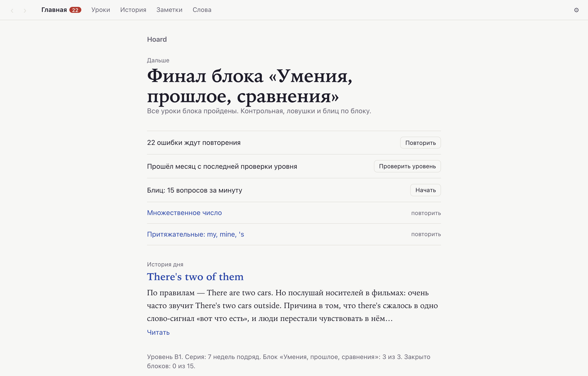</picture>
      <p align="center">Главная: что делать дальше</p>
    </td>
    <td width="50%">
      <picture><source media="(prefers-color-scheme: dark)" srcset="docs/screenshots/gloss-dark.png">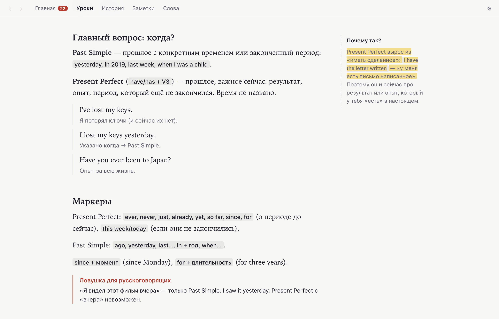</picture>
      <p align="center">Урок с глоссой и ловушкой</p>
    </td>
  </tr>
  <tr>
    <td width="50%">
      <picture><source media="(prefers-color-scheme: dark)" srcset="docs/screenshots/stories-dark.png">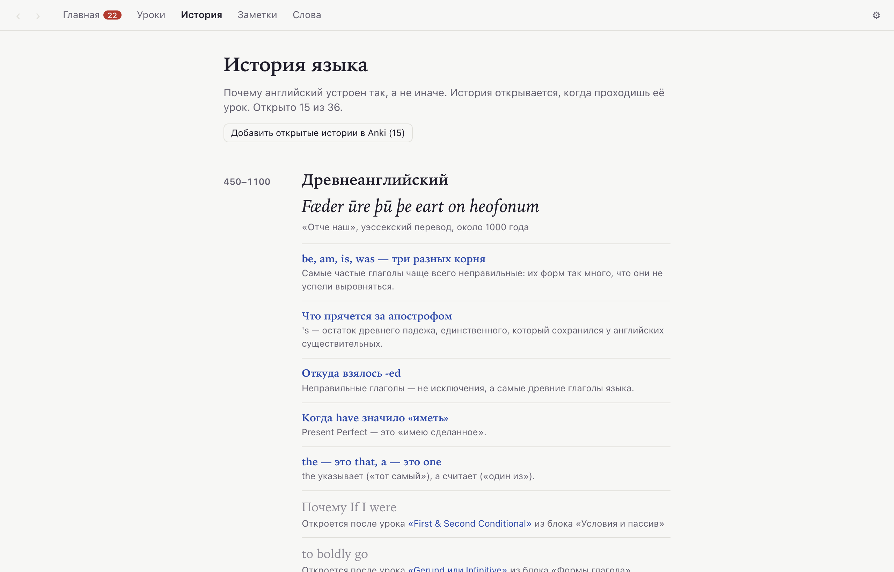</picture>
      <p align="center">История языка по эпохам</p>
    </td>
    <td width="50%">
      <picture><source media="(prefers-color-scheme: dark)" srcset="docs/screenshots/map-dark.png">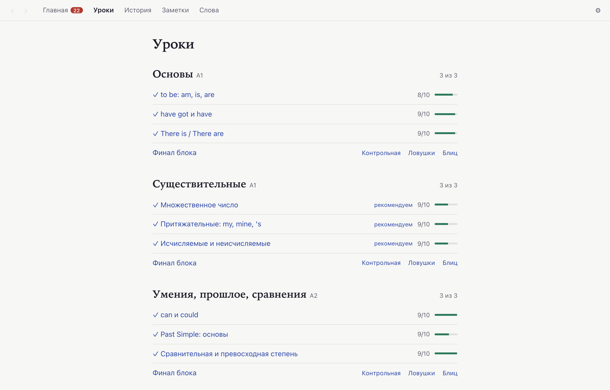</picture>
      <p align="center">Уроки и освоенность тем</p>
    </td>
  </tr>
  <tr>
    <td width="50%">
      <picture><source media="(prefers-color-scheme: dark)" srcset="docs/screenshots/notes-dark.png">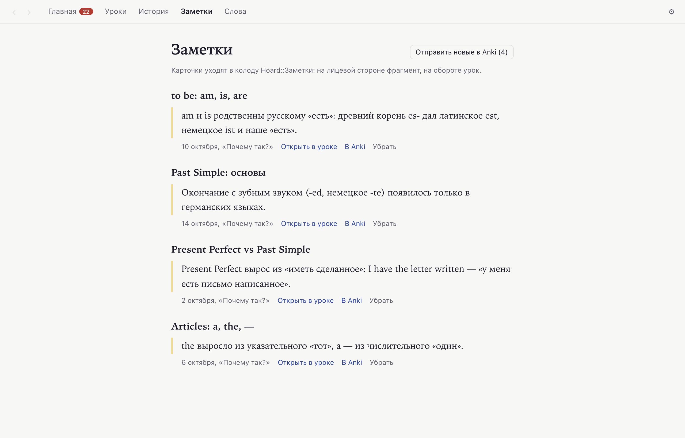</picture>
      <p align="center">Заметки, готовые для Anki</p>
    </td>
    <td width="50%">
      <picture><source media="(prefers-color-scheme: dark)" srcset="docs/screenshots/blitz-dark.png">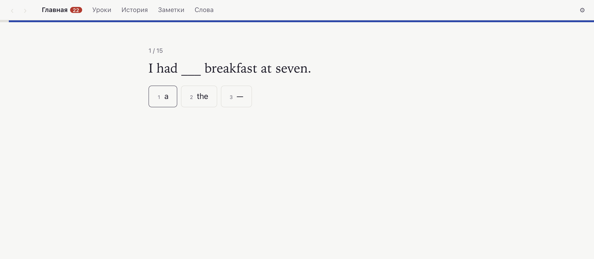</picture>
      <p align="center">Блиц: 15 вопросов за минуту</p>
    </td>
  </tr>
</table>

<p align="center">
  <picture><source media="(prefers-color-scheme: dark)" srcset="docs/screenshots/phone-home-dark.png">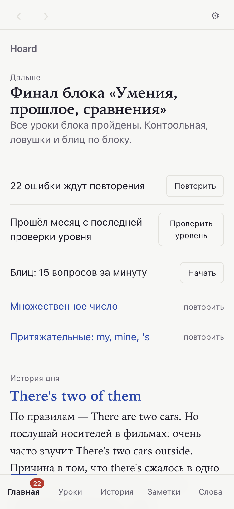</picture>
  &nbsp;&nbsp;
  <picture><source media="(prefers-color-scheme: dark)" srcset="docs/screenshots/phone-lesson-dark.png">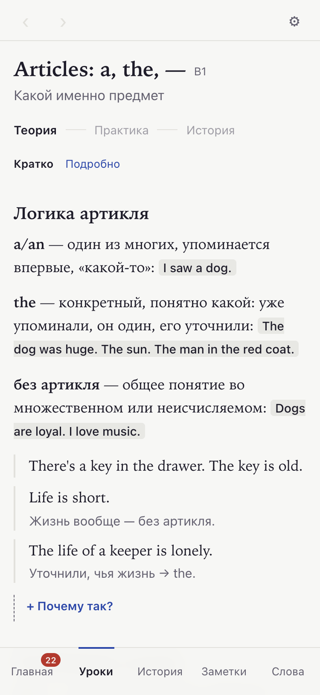</picture>
</p>

## Языки

Теория A1–B1 написана на твоём родном языке, с B2 — на английском. Ловушки всегда на родном языке и написаны специально под него, а не переведены: носители разных языков ошибаются в разном.

| Родной язык | Статус |
|---|---|
| Русский | Готов |
| Испанский | Готов |
| Немецкий | Готов |
| Польский | Готов |

Интерфейс тоже на родном языке. Его выбирают при первом запуске и меняют в настройках. Один и тот же урок, где ловушка и глосса написаны под каждый язык:

<table>
  <tr>
    <td width="33%"><picture><source media="(prefers-color-scheme: dark)" srcset="docs/screenshots/gloss-es-dark.png">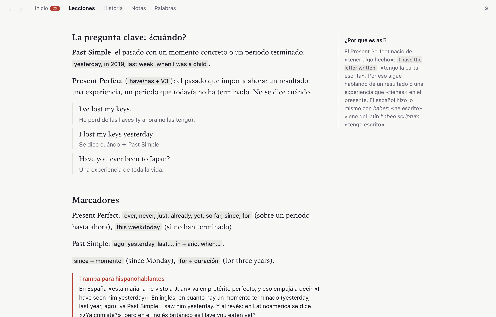</picture><p align="center">Español</p></td>
    <td width="33%"><picture><source media="(prefers-color-scheme: dark)" srcset="docs/screenshots/gloss-de-dark.png">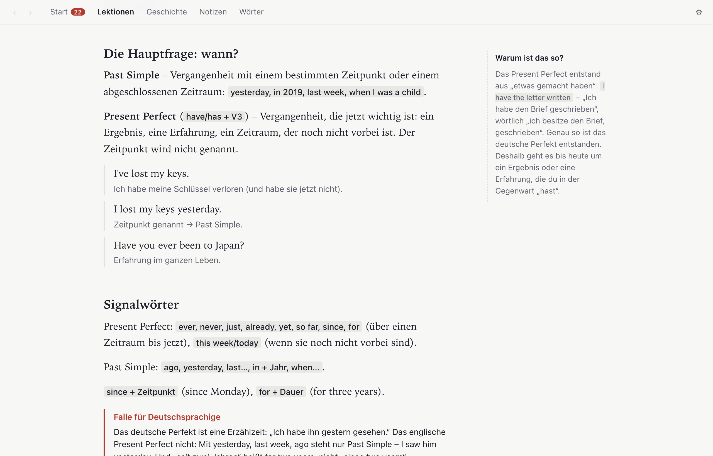</picture><p align="center">Deutsch</p></td>
    <td width="33%"><picture><source media="(prefers-color-scheme: dark)" srcset="docs/screenshots/gloss-pl-dark.png">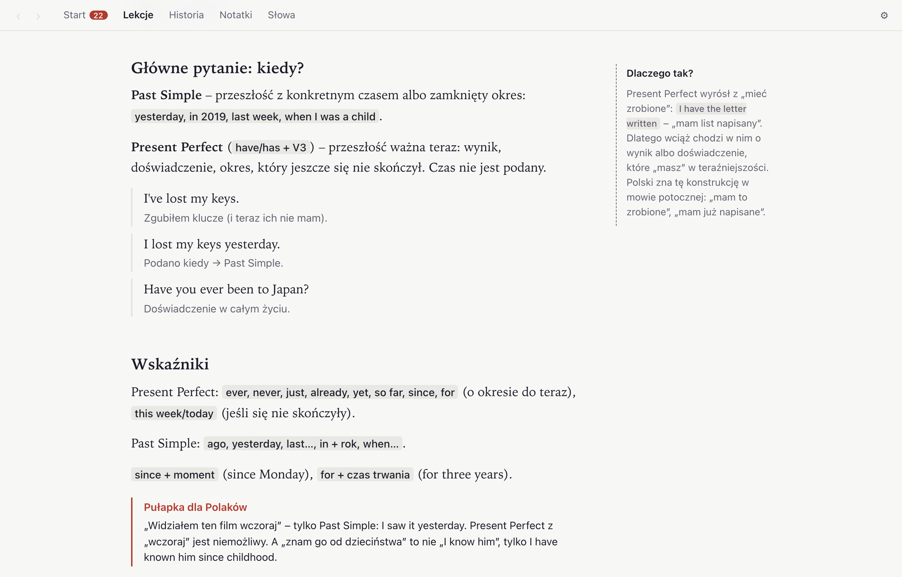</picture><p align="center">Polski</p></td>
  </tr>
</table>


## Установка

**Mac, Windows, Linux.** Скачай установщик со страницы [Releases](https://github.com/ShevlukVasiliy/Hoard-English/releases/latest). Сборки пока не подписаны, поэтому при первом запуске нужен один лишний шаг:
- macOS: открой Hoard один раз и закрой предупреждение. Затем зайди в **Системные настройки → Конфиденциальность и безопасность**, пролистай вниз и нажми **Всё равно открыть** рядом с Hoard.
- Windows: в окне SmartScreen нажми **Подробнее**, затем **Выполнить в любом случае**.

**iPhone и Android.** Открой [веб-версию](https://shevlukvasiliy.github.io/Hoard-English/) и добавь её на экран «Домой». На iPhone — через Safari: **Поделиться**, затем **На экран «Домой»**. После этого Hoard работает без интернета, как обычное приложение. Anki и напоминания доступны только на компьютере.

## Синхронизация

Своего сервера у Hoard нет. Чтобы заниматься и на компьютере, и на телефоне, подключи аккаунт GitHub в настройках. Прогресс хранится в секретном гисте, который видишь только ты, и его можно зашифровать паролем. Каждое устройство записывает свой журнал действий, поэтому ничего не перезаписывается. Даже если ты занимался на обоих устройствах без интернета, прогресс сойдётся.

## Приватность

Прогресс, заметки и настройки хранятся на твоём устройстве. Hoard никуда их не отправляет. Исключения: твой собственный гист, если включена синхронизация, и Anki на твоём компьютере, если ты им пользуешься. Аналитики, трекинга и ИИ нет.

## Источники

- **Уровни грамматики и слов**: CEFR-J Grammar Profile (ver. 20180315) и CEFR-J Wordlist (ver. 1.5), Yukio Tono, Tokyo University of Foreign Studies, [cefr-j.org](http://www.cefr-j.org/download.html), через [Open Language Profiles](https://github.com/openlanguageprofiles/olp-en-cefrj). Бесплатны для исследовательского и коммерческого использования при указании источника. Оригинал списка слов лежит в `shared/data/`, лицензия проекта на него не распространяется.
- **Уроки, задания, банк входного теста, ловушки и истории** написаны специально для Hoard и не копируют учебники.
- **Эпиграфы эпох** в «Истории языка» взяты из текстов в общественном достоянии: древнеанглийский «Отче наш», Чосер, Шекспир, Сэмюэл Джонсон.
- **Что почитать об истории английского**, если истории зацепят: David Crystal, *The Stories of English*; Albert C. Baugh, Thomas Cable, *A History of the English Language*; [Online Etymology Dictionary](https://www.etymonline.com/).
- **[Anki](https://apps.ankiweb.net/)** и **[AnkiConnect](https://ankiweb.net/shared/info/2055492159)**: коллекцию Hoard только читает, а карточки добавляет через AnkiConnect.

## Для разработчиков

Hoard собран на Tauri 2 (десктоп) и React с Vite. Версия для телефона — та же сборка в виде PWA на GitHub Pages. Понадобится [Bun](https://bun.sh), а для десктопа ещё и Rust.

```bash
bun install
bun run app:dev    # десктопное приложение
bun run dev        # веб-версия на localhost:1420, данные в localStorage
```

Проверки перед коммитом:

```bash
bun run typecheck
bun test
cd src-tauri && cargo check
```

Тест чтения настоящей коллекции Anki (только чтение): `cd src-tauri && cargo test -- --ignored`.

В веб-версии любой экран открывается по маршруту в адресе, например `http://localhost:1420/#{"name":"lesson","id":"past-perfect"}`. На десктопе данные лежат в `~/.eng-teacher/`. Коллекция Anki открывается только на чтение; новые карточки идут через AnkiConnect и ждут в очереди, пока Anki закрыт.

Установщики собирает GitHub Actions, когда в репозиторий приходит тег `v*`. Скриншоты пересоздаются командой `bun scripts/screenshots.ts`, пока запущен `bun run dev`. Идея продукта описана в [CONCEPT.md](CONCEPT.md), визуальный язык — в [UX.md](UX.md), план — в [STAGE_PLAN.md](STAGE_PLAN.md).

## Лицензия

[MIT](LICENSE)
